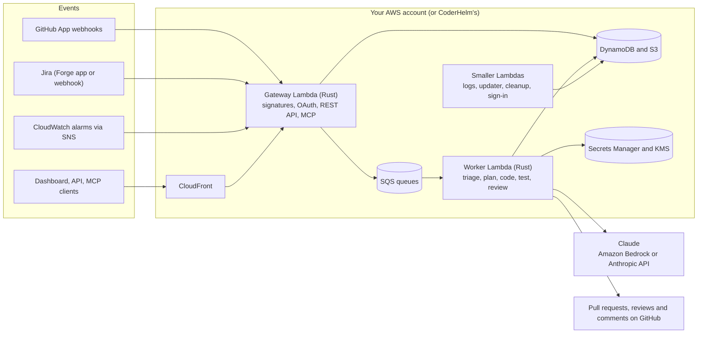

# CoderHelm Platform: the self-hosted AI coding agent for GitHub and Jira on AWS

[](https://github.com/CoderHelm/coderhelm-platform/actions/workflows/ci.yml)
[](https://github.com/CoderHelm/coderhelm-platform/releases/latest)
[](LICENSE.md)
[](https://docs.coderhelm.com/self-host/)

This repository is the engine of [CoderHelm](https://coderhelm.com), the AI coding agent that turns GitHub issues and Jira tickets into pull requests and then stays on the code. It holds the agent (a Rust gateway and worker on AWS Lambda), the AWS CDK infrastructure, the Jira app and the self-host installer that runs all of it in your own AWS account, with Claude through Amazon Bedrock or an Anthropic API key.

The same code runs the hosted service at [app.coderhelm.com](https://app.coderhelm.com) and every self-hosted install. The dashboard, docs site and website are in [CoderHelm/coderhelm](https://github.com/CoderHelm/coderhelm).

[Docs](https://docs.coderhelm.com) · [Self-host install guide](https://docs.coderhelm.com/self-host/install/) · [Releases](https://github.com/CoderHelm/coderhelm-platform/releases) · [API](https://docs.coderhelm.com/api) · [Changelog](https://docs.coderhelm.com/changelog) · [Security](https://docs.coderhelm.com/security)

## What runs here

- **Tickets to pull requests.** Assign a GitHub issue or Jira ticket, add the `coderhelm` label or comment `/coderhelm`. The worker triages it, plans the files it will touch, writes the change on a `coderhelm/` branch, runs your build and tests in a sandbox with no credentials, reviews its own work and opens the pull request.
- **After the pull request.** Fixes failing CI, answers review comments, resolves conflicts and, with auto merge on, merges only the exact commit it reviewed after a person approves.
- **PR reviewer.** Reviews any pull request with the review label: line comments, a risk level, and a verdict that requests changes only for a named, evidenced problem.
- **Alerts, tests and logs.** CloudWatch alarms through SNS become fix pull requests; flaky tests are detected and quarantined; chosen log groups are read every six hours.
- **Security fixes and stale pull requests.** Dependency advisories checked for reachability in your code, with tiers, deadlines and daily limits; stale pull requests warned and closed, off by default.
- **Chat, knowledge and MCP.** Chat reads the code and cites paths and lines; knowledge syncs from Notion, Confluence, Google Drive, Sanity, GitHub, websites and files, and can be used from Amazon Bedrock; CoderHelm is also an MCP server for Claude, Cursor and VS Code.
- **Team controls.** Agent permissions (allow, ask or deny), custom roles, monthly token limits, usage and audit records, a public REST API with team API keys and signed outbound webhooks.

Each of these has a page in the [docs](https://docs.coderhelm.com).

## Architecture



1. The **gateway** checks each webhook's signature, finds the team and repository, serves the REST API and the MCP server, and puts a job on the queue.
2. The **worker** runs the job: runs, reviews, plans, CI fixes, security fixes and the rest of the agent work. Every agent action goes through the team's agent permissions, so anything risky waits for a person.
3. The **infrastructure** is AWS CDK v2, built from one JSON config, so the hosted service and a self-hosted install are the same stacks with different settings.
4. The **installer** (`coderhelm-selfhost`) installs, checks, updates, backs up and removes a self-hosted install.

| Component | Technology |
|---|---|
| Gateway and worker | Rust, async, compiled for ARM64 Lambda |
| Models | Claude, through Amazon Bedrock or the Anthropic API |
| Infrastructure | AWS CDK v2 (TypeScript), deployed as CloudFormation |
| Queue, storage, sign-in | Amazon SQS, DynamoDB, S3, Cognito |
| Web | CloudFront in front of the dashboard and the API |
| Jira | Atlassian Forge app (Node.js) |
| Installer | Node.js 20+, no global install |

## Self-host in your own AWS account

The easiest way is the [browser install guide](https://docs.coderhelm.com/self-host/install/): one click opens an AWS quick create page, the guide follows the install, creates your GitHub App in one click, checks model access on Amazon Bedrock and helps with your own domain.

From a terminal (Node.js 20+ and the AWS CLI v2, signed in to your account):

```sh
npx -y github:CoderHelm/coderhelm-platform init     # a few questions, writes coderhelm.config.json
npx -y github:CoderHelm/coderhelm-platform deploy   # deploys, uploads the dashboard, creates your GitHub App
npx -y github:CoderHelm/coderhelm-platform doctor   # checks the install and says how to fix what fails
```

Or with the release's install script, which checks the installer's signature before it runs anything:

```sh
curl -fsSL https://github.com/CoderHelm/coderhelm-platform/releases/latest/download/install.sh | sh
```

No Rust, Docker or domain needed: releases ship built Lambda code, and without a domain CoderHelm runs on a CloudFront address.

**Updates.** Press Update in **Settings, then System**, let the install update itself in a maintenance window on the Stable or nightly Beta channel, or run:

```sh
npx -y github:CoderHelm/coderhelm-platform version   # the installed release and the latest one
npx -y github:CoderHelm/coderhelm-platform update    # the latest release, or --to vX.Y.Z
npx -y github:CoderHelm/coderhelm-platform rollback  # back to the previous release
```

Guides: [requirements](https://docs.coderhelm.com/self-host/requirements), [quick start](https://docs.coderhelm.com/self-host/quick-start), [what it creates in your AWS account](https://docs.coderhelm.com/self-host/aws-account), [updates](https://docs.coderhelm.com/self-host/updates), [hybrid](https://docs.coderhelm.com/self-host/hybrid), [troubleshooting](https://docs.coderhelm.com/self-host/troubleshooting) and [uninstall](https://docs.coderhelm.com/self-host/uninstall). Their source is [`docs/self-host/`](docs/self-host/index.md).

## How releases are signed and verified

An install or update uses nothing from a release until two checks pass:

1. **The tag is on `main` and vouched for.** It is an annotated `vX.Y.Z` tag on a commit on `main`, either signed by a maintainer SSH key pinned in [`selfhost/maintainers.json`](selfhost/maintainers.json) or attested by the automatic release workflow on `main` with a keyless Sigstore signature.
2. **The release was built and signed by this repository's release workflow from that commit.** `SHA256SUMS` carries a keyless cosign signature from [`release.yml`](.github/workflows/release.yml) on that tag, and every file must match its checksum.

If any check fails, nothing is installed. To check a release yourself with cosign:

```sh
V=v0.8.59   # the release to check
R=CoderHelm/coderhelm-platform
COMMIT=$(git ls-remote "https://github.com/$R.git" "refs/tags/$V^{}" | cut -f1)
for f in SHA256SUMS SHA256SUMS.sigstore.json; do
  curl --proto =https -fsSLO "https://github.com/$R/releases/download/$V/$f"
done
cosign verify-blob --bundle SHA256SUMS.sigstore.json \
  --certificate-identity "https://github.com/$R/.github/workflows/release.yml@refs/tags/$V" \
  --certificate-oidc-issuer https://token.actions.githubusercontent.com \
  --certificate-github-workflow-repository "$R" \
  --certificate-github-workflow-ref "refs/tags/$V" \
  --certificate-github-workflow-sha "$COMMIT" \
  SHA256SUMS
```

The full procedure, including the tag check and the Launch Stack template, is in [How updates are kept safe](docs/self-host/updates-security.md).

## Repository layout

| Path | What it is |
|---|---|
| [`services/gateway/`](services/gateway) | Rust Lambda: webhooks (GitHub, Jira, SNS, knowledge), OAuth, the REST API, the MCP server, queue dispatch |
| [`services/worker/`](services/worker) | Rust Lambda: runs, reviews, plans, CI fixes and the other agent work |
| [`services/common/`](services/common) | Shared Rust code: models, knowledge, agent permissions, notifications |
| [`lambda/`](lambda) | Smaller Lambdas: log analyzer, updater, MCP proxy, stuck run cleanup, sign-in messages, install helpers |
| [`coderhelm-jira/`](coderhelm-jira) | Atlassian Forge app that sends Jira Cloud events to the gateway |
| [`infra/`](infra) | AWS CDK v2 for all cloud infrastructure, built from one config file ([`infra/config/`](infra/config)) |
| [`installer/`](installer) | `coderhelm-selfhost`: init, deploy, doctor, update, rollback, auto-update, backup, migrate, uninstall |
| [`selfhost/`](selfhost) | Release metadata: maintainer keys, migration notes, the dashboard version, `install.sh`, the Launch Stack bootstrap |
| [`plugins/`](plugins) | Example plugin packages |
| [`docs/`](docs) | Self-host guides, the OpenAPI document and operations notes |
| [`scripts/`](scripts) | Build, release protection and maintenance scripts |

## Development

| Tool | Version | Notes |
|---|---|---|
| Rust | pinned in [`services/rust-toolchain.toml`](services/rust-toolchain.toml) | `rustup` installs it on first build |
| `cargo-zigbuild` | 0.24.0 | `cargo install cargo-zigbuild --version 0.24.0 --locked`, plus [Zig](https://ziglang.org/download/) |
| Node.js | 20 or newer | infra, installer, Jira app, MCP proxy |
| Python | 3 | the smaller Lambdas' tests |
| AWS CLI | v2 | only to deploy |

Build and test, the same commands CI runs:

```sh
# Rust gateway and worker
cd services
cargo fmt --check --all
cargo clippy --workspace -- -D warnings
cargo test --workspace
cd ..
bash scripts/rust-build.sh dist          # dist/gateway.zip and dist/worker.zip for Lambda

# Infrastructure: config validation and synth tests, then synth
cd infra && npm ci && npm test && npx cdk synth && cd ..

# Installer
cd installer && npm test && cd ..

# Smaller Lambdas
python3 -m unittest discover -s lambda/tests
node --test lambda/pre-signup/handler.test.js
```

`npx cdk synth` uses the hosted deployment's config by default; pass `-c config=<file>` for another. Every deployment is built from one JSON config: see the [config reference](docs/self-host/config-reference.md). Secrets live in AWS Secrets Manager at `coderhelm/<stage>/secrets`, and a self-hosted install's are created and filled by the installer.

## Deploys and releases

- [`deploy.yml`](.github/workflows/deploy.yml) deploys `main` to the hosted service.
- [`auto-release.yml`](.github/workflows/auto-release.yml) cuts a nightly Beta release of `main`'s deployed head and promotes the newest Beta to Stable once it has been out for a day with no open release blocker, with no person in the loop and no stored signing key.
- [`release.yml`](.github/workflows/release.yml) publishes a `vX.Y.Z` tag as a self-host release: built Lambda zips, the dashboard, the source, the installer, `install.sh` and the Launch Stack template, with signed checksums and build provenance.

## Security

Please report vulnerabilities privately, as described in [SECURITY.md](SECURITY.md). For how CoderHelm protects code, accounts and secrets, read the [security overview](https://docs.coderhelm.com/security) and the self-host [security model](docs/self-host/security.md).

## Contributing and support

Issues and pull requests are welcome. For a bigger change, open an issue first so we can agree on the approach. Questions and support: [support@coderhelm.com](mailto:support@coderhelm.com).

## License

CoderHelm is licensed under the [Functional Source License, Version 1.1, with Apache 2.0 as the future license](LICENSE.md) (FSL-1.1-ALv2). In plain words:

- You can run it, change it and self-host it for your own company.
- You can't offer it, or something built from it, as a competing hosted product.
- Each release becomes Apache 2.0 two years after it ships.

The full terms are in [LICENSE.md](LICENSE.md).
